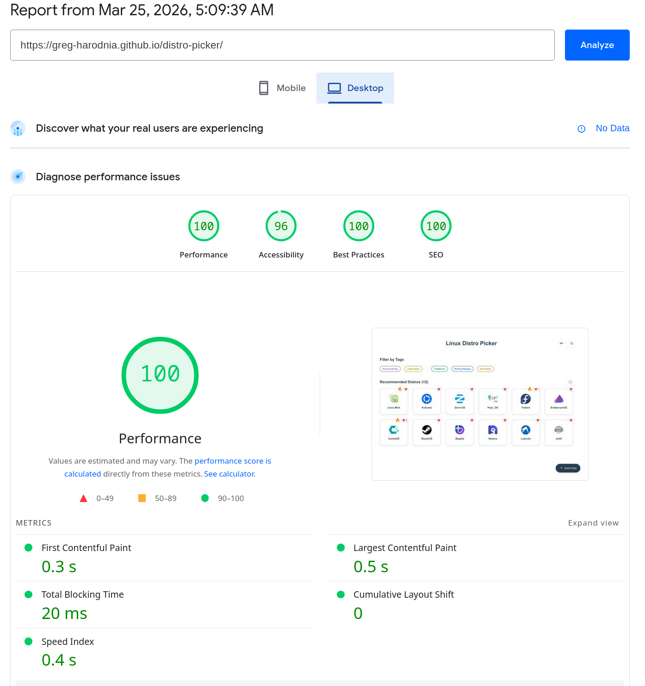

# Linux Distribution Picker

A modern Linux distribution picker built with SvelteKit to help users find the perfect Linux distribution for their needs based on gaming, development, user-friendliness, and other criteria.

 

### Install dependencies

```bash
bun install
```

### Environment

Copy `.env.example` to `.env.local` and set `PUBLIC_SUPABASE_URL` to your
Supabase project URL. It is read at build time by the client (`$env/static/public`)
and by the CSP `connect-src` / preconnect tags in `src/app.html`. The same
variable must be set in the Vercel project settings, or the build fails.

### Start development server

```bash
bun --bun vite dev
```

### Create production build

```bash
bun --bun vite build
```

### Preview production build

```bash
bun --bun vite preview
```

## 📝 Blog

Blog posts live as Markdown files in `src/lib/blog/posts/`:

```
posts/
├── <slug>.<lang>.md     e.g. dont-use-obs.en.md
```

- Each file starts with a `---` frontmatter block: `title`, `date`, optional `description` and `pinned`.
- A post is served in the URL's locale; if no `<slug>.<lang>.md` exists, the English file is used as the default fallback.
- Blog pages are **dynamic** (`prerender = false`): the markdown is read and rendered by the server on each request, so it is part of the SSR response (not baked into the build output) and blog pages stay indexable (canonical, hreflang, JSON-LD `BlogPosting`).
- **Views & likes** are stored in Supabase. Apply the migrations in `supabase/migrations/` in order (`0001`–`0004`) in your Supabase project (SQL editor). Without them, the counters simply show 0 and the current visit/like is still tracked locally.

## 📁 Project Structure

```
distro-picker/
├── docs/
│   ├── SEO.png
│   └── SEO_mobile.png
├── scripts/
│   ├── check-quiz.ts         # `bun run check:quiz`
│   └── gen-sitemap.ts        # `prebuild`: writes static/sitemap.xml
├── supabase/migrations/      # Apply in order in the Supabase SQL editor
├── src/
│   ├── app.css
│   ├── app.html
│   ├── hooks.server.ts           # Rewrites <html lang> per URL during prerender
│   ├── lib/
│   │   ├── actions/
│   │   │   └── dragScroll.ts
│   │   ├── blog/
│   │   │   ├── content.ts        # Frontmatter parsing + locale fallback
│   │   │   ├── markdown.ts
│   │   │   ├── posts/            # <slug>.<lang>.md
│   │   │   └── types.ts
│   │   ├── components/
│   │   │   ├── icons/
│   │   │   ├── modals/           # Modal.svelte + one component per dialog
│   │   │   ├── BackLink.svelte
│   │   │   ├── BlogLink.svelte
│   │   │   ├── Confetti.svelte
│   │   │   ├── DistroDetails.svelte
│   │   │   ├── DistroGrid.svelte
│   │   │   ├── DistroTierSection.svelte
│   │   │   ├── ErrorDisplay.svelte
│   │   │   ├── FilterGroup.svelte
│   │   │   ├── GalleryStage.svelte   # Interactive screenshot viewer (swipe, anchored pinch-zoom)
│   │   │   ├── LanguageToggle.svelte
│   │   │   ├── OptimizedImage.svelte
│   │   │   ├── PageTopBar.svelte
│   │   │   ├── Quiz.svelte
│   │   │   ├── ScreenshotGallery.svelte # Stage + filmstrip, shared by modal and distro page
│   │   │   ├── TagFilter.svelte
│   │   │   ├── ThemeToggle.svelte
│   │   │   └── galleryState.svelte.ts   # Shared index/preload state for both gallery surfaces
│   │   ├── i18n/
│   │   │   ├── locale.ts
│   │   │   └── translations.ts
│   │   ├── locales/
│   │   │   ├── types.ts      # Type definitions
│   │   │   ├── en.json       # English (bundled: default + fallback)
│   │   │   └── be.json       # Belarusian (fetched on demand for /be)
│   │   ├── stores/
│   │   │   ├── core/
│   │   │   │   └── filters.ts       # Pure filter engine (tiers, tag matching)
│   │   │   ├── state/
│   │   │   │   └── catalog.svelte.ts # Shared picker state (runes singleton)
│   │   │   └── theme.ts
│   │   ├── types/
│   │   │   └── quiz.ts
│   │   ├── utils/
│   │   │   ├── body.ts
│   │   │   ├── data.ts
│   │   │   ├── index.ts
│   │   │   ├── logoContrast.ts
│   │   │   ├── storage.ts
│   │   │   ├── validation.ts
│   │   │   └── warmup.ts
│   │   ├── distros.json
│   │   ├── distros.ts
│   │   ├── quiz-results.ts
│   │   ├── screenshots.ts        # Shared static/screenshots discovery
│   │   ├── seo.ts
│   │   ├── supabase.ts
│   │   ├── tagGroups.ts
│   │   └── types.ts
│   └── routes/
│       ├── +layout.server.js     # Returns the locale from the URL (`/` -> en, `/be` -> be)
│       ├── +layout.ts            # Loads the active locale's translations
│       ├── +layout.svelte        # Seeds the locale store, canonical + hreflang
│       └── [[lang]]/             # Optional locale segment
│           ├── +page.server.ts
│           ├── +page.svelte
│           ├── blog/             # Dynamic (prerender = false)
│           │   ├── +page.server.ts
│           │   ├── +page.svelte
│           │   └── [slug]/{+page.server.ts,+page.svelte}
│           └── distro/[id]/
│               ├── +page.server.ts   # entries() prerenders both /distro/x and /be/distro/x
│               └── +page.svelte
├── static/
│   ├── fonts/                # Self-hosted Ubuntu / Geist Mono / Instrument Serif
│   ├── screenshots/          # Distro screenshots
│   ├── .nojekyll
│   ├── llms.txt, llms-full.txt
│   ├── robots.txt
│   ├── sitemap.xml           # Generated by `prebuild`; includes both language variants
│   └── *.webp/*.svg          # Distro logo images
├── vercel.json               # Security + cache headers (Vercel)
├── package.json
├── svelte.config.js
└── tsconfig.json
```

## 🗄️ Database Structure (Supabase)

Schemas live in `supabase/migrations/` and are applied by hand in the Supabase
SQL editor, in numeric order.

### `distros` table

| Column | Type | Description |
|--------|------|-------------|
| id | text | Primary key (same as `id` in distros.json) |
| likes | integer | Number of likes |

### `blog_posts` table

| Column | Type | Description |
|--------|------|-------------|
| slug | text | Primary key (post slug) |
| views | integer | View count |
| likes | integer | Like count |

### `messages` table

| Column | Type | Description |
|--------|------|-------------|
| id | bigint | Identity primary key |
| name / email / message | text | Contact form fields (length-checked) |
| created_at | timestamptz | Insert time |

RLS is enabled on all three tables. The `anon` role has **SELECT only** on
`distros`/`blog_posts`; counters are mutated through the `SECURITY DEFINER`
functions created in `0004_atomic_counters.sql`, which apply a delta in a
single atomic statement so concurrent likes/views cannot overwrite each other.
`messages` is insert-only — submissions are not readable with the anon key.

## 🌐 Supported Languages

The language is part of the URL, so every version is prerendered as static,
indexable HTML:

| Language | Code | Native Name | URL |
|----------|------|-------------|-----|
| English (default, `x-default`) | `en` | English | `/`, `/distro/{id}` |
| Belarusian | `be` | Беларуская | `/be`, `/be/distro/{id}` |

### How it works

1. **URL is the source of truth** - `/` serves English, `/be` serves
   Belarusian. The root layout reads `params.lang` and seeds the locale store
   *before* rendering, so the emitted HTML (title, description, content,
   JSON-LD, `<html lang>`) matches the URL. No JavaScript required to see the
   right language — search engines and AI crawlers get the full Belarusian
   content directly in the response body.
2. **Switching** - the language toggle renders real links between language
   variants (crawlers can discover `/be` from them), so the choice survives
   bookmarks and shared links. Choosing a language stores an explicit
   preference in `localStorage`, used only by the auto-redirect below — the
   URL remains the source of truth for what is rendered. There is no hash
   state.
3. **Auto-redirect (client-side only)** - after a full page load of an
   English page, visitors with a Belarusian preference — an explicit stored
   choice, `be`-family browser language, or the `Europe/Minsk` timezone — are
   redirected to the `/be` equivalent (e.g. `/distro/mint` → `/be/distro/mint`).
   Since this runs only in the browser *after* the English HTML is served,
   crawlers (which don't run the app's JavaScript) always see — and index —
   the English version; it never affects the prerendered output.
4. **SEO** - each page emits self-referencing canonical plus
   `hreflang="en"` / `hreflang="be"` / `hreflang="x-default"` alternates, and
   the sitemap lists both variants. `src/hooks.server.ts` rewrites
   `<html lang>` per URL at build time.

### Translations

English (`en`) is bundled statically — it is the default locale *and* the
fallback for every other one. Other locales are fetched on demand: the root
layout's `load` awaits the active locale before rendering (`be.json` is a
separate chunk, so an English page never downloads it). Missing keys fall back
to English.

### SEO

The app has a great SEO score (a11y is 96 due to tag color contrasts in the light theme).



<br>**Find Your Perfect Linux Distribution Today! 🐧**
